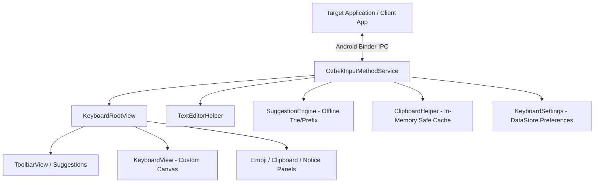

# IME Stability, Architecture & Reliability Audit — Özbek Keyboard

**Package:** `uz.ozbekkeyboard`  
**Target Platform:** Android OS (AOSP, Samsung One UI, Xiaomi HyperOS, Honor MagicOS, EMUI, Pixel)  
**Audit Date:** November 2026  

---

## 1. Architectural Architecture & Process Model

Özbek Keyboard is implemented as an official Android `InputMethodService` running as an isolated system input service.



### 1.1. Service Lifecycle Management
- **`onCreate()`**: Initializes non-view singletons (`KeyboardSettings`, `SuggestionEngine`, `ClipboardHelper`). No heavy disk I/O on the main thread.
- **`onCreateInputView()`**: Instantiates `KeyboardRootView`, attaches listeners, and pre-renders initial layouts.
- **`onStartInputView(info: EditorInfo?, restarting: Boolean)`**:
  - Resets keyboard mode to `ALPHABET` (or auto-switches to `SYMBOLS_1` if `isNumericInput(info)` is true).
  - Inspects `EditorInfo.imeOptions` to resolve the dynamic Action Enter key icon (`Search`, `Send`, `Done`, `Go`, `Next`, `Return`).
  - Evaluates auto-capitalization state based on `EditorInfo.inputType`.
  - Isolates sensitive password fields (`isPasswordField`) to protect user privacy.
- **`onFinishInputView(finishingInput: Boolean)`**:
  - Cleans up active touch state via `keyboardView.resetTouchState()`, releasing any held keys, popup overlays, trackpad cursors, or backspace repeat timers.
- **`onConfigurationChanged(newConfig: Configuration)`**:
  - Automatically recalculates view geometry on device orientation rotation or font/display density scaling.

---

## 2. InputConnection Robustness & Remote IPC Error Handling

In Android, `InputConnection` operations communicate over Binder IPC with client applications. Faulty or non-standard client implementations (e.g., custom WebViews, banking apps with anti-tamper wrappers, Flutter or React Native custom text inputs) frequently return unexpected results or throw `DeadObjectException` or `RuntimeException`.

### 2.1. Defensive Exception Boundaries
Every single `InputConnection` call in `TextEditorHelper.kt` is wrapped in defensive try/catch blocks:
- `handleDelete(inputConnection)`
- `shouldAutoCapitalize(inputConnection, editorInfo)`
- `handleSpaceKey(inputConnection, doubleSpacePeriod)`
- `extractCurrentWordPrefix(inputConnection)`
- `replaceWordPrefix(inputConnection, prefix, suggestion)`

If an application crashes its input thread or throws a remote IPC exception, Özbek Keyboard will **never** crash the system input pipeline or throw an unhandled exception.

### 2.2. Robust Fallback Deletion (`sendFallbackDelete`)
When editing text in non-standard input fields:
1. First, check if an active text selection exists. If yes, commit empty string `""` to clear it.
2. If no selection, query `getTextBeforeCursor(64, 0)` and calculate the exact grapheme cluster length using `calculateDeleteCount()`.
3. Call `inputConnection.deleteSurroundingText(deleteCount, 0)`.
4. **Fallback Mechanism:** If `deleteSurroundingText` returns `false` or throws an exception, `TextEditorHelper` automatically dispatches hardware-level key events:
   ```kotlin
   inputConnection.sendKeyEvent(KeyEvent(KeyEvent.ACTION_DOWN, KeyEvent.KEYCODE_DEL))
   inputConnection.sendKeyEvent(KeyEvent(KeyEvent.ACTION_UP, KeyEvent.KEYCODE_DEL))
   ```
   This ensures deletion always works, even in severely degraded or non-compliant client apps.

### 2.3. Unicode Grapheme Cluster Integrity
Uzbek Latin typing frequently combines characters with diacritics, modifier letters (e.g. `ʻ` U+02BB in legacy text), surrogate pairs, and flag emojis (e.g., Regional Indicator pair `🇺🇿` = `\uD83C\uDDFA\uD83C\uDDFF`).
- **Emoji Cursor Stepping:** `calculateNewCursorPosition()` treats regional indicator pairs and surrogate emoji clusters as single indivisible grapheme units. The cursor cannot be moved into the middle of a surrogate pair, preventing corrupted `` rendering.
- **Deletion Safety:** Deletion counts inspect surrogate boundaries and regional indicator sequences, removing the entire emoji cluster in a single backspace tap.

---

## 3. Rendering Performance & Memory Profiling

Keyboards require sub-16ms frame times (60fps–120fps) during typing, dragging, and popup rendering. Heap allocations during drawing trigger Android's Garbage Collector (GC), causing micro-stutters and input lag.

### 3.1. Zero-Allocation Draw Pipeline
- **Eliminated Rect Allocations:** `KeyboardView.kt` pre-allocates a fixed pool of 10 `RectF` instances (`variantBoundsPool = List(10) { RectF() }`). During long-press popup display, bounds are mutated in-place rather than instantiated on every draw frame.
- **Cached Paint & Font Metrics:** All `Paint` objects (`backgroundPaint`, `keyPaint`, `textPaint`, `popupPaint`, `keyShadowPaint`) are allocated once during view construction.
- **Vector Drawable Cache:** Vector icons (`ic_backspace.xml`, `ic_shift.xml`, `ic_enter_*.xml`, `ic_globe.xml`) are mutated and cached in `iconCache: MutableMap<Int, Drawable>`, avoiding repeated XML inflation and drawable allocation.

### 3.2. Responsive Input Throttling
- **Spacebar Trackpad:** Drag sensitivity uses a dynamic density-scaled threshold (`trackpadThresholdPx`). Step calculations are integer-quantized, preventing IPC flood while delivering silky-smooth cursor navigation.
- **Continuous Backspace:** Uses an initial pause of 400ms followed by a steady 50ms repeat rate (`backspaceRepeatIntervalMs`), balanced to avoid Binder transaction buffer saturation.

---

## 4. Audio Feedback & TalkBack Accessibility

### 4.1. Audio Feedback
When `soundOnPress` is enabled in settings, `KeyboardView` queries the system `AudioManager` and triggers standard Android keyboard sound effects:
- **Spacebar:** `AudioManager.FX_KEYPRESS_SPACEBAR`
- **Backspace:** `AudioManager.FX_KEYPRESS_DELETE`
- **Enter:** `AudioManager.FX_KEYPRESS_RETURN`
- **Standard Keys:** `AudioManager.FX_KEYPRESS_STANDARD`

Sound respects system-wide ringer mode (Silent/Vibrate) automatically through standard Android audio effect routing.

### 4.2. Accessibility (TalkBack)
Every key press dispatches modern Uzbek spoken feedback via `announceForAccessibility()`:
- `KeyType.BACKSPACE` -> *"Öçiriş"*
- `KeyType.ENTER` -> *"Kiritiş"*
- `KeyType.SPACE` -> *"Probel"*
- `KeyType.SWITCH_SYMBOLS` -> *"Belgilar"*
- `KeyType.SWITCH_PAGE` -> *"Keyingi sahifa"*
- `KeyType.GLOBE` -> *"Tilni almaştiriş"*
- `KeyType.COMMA` -> *"Vergul"*
- `KeyType.PERIOD` -> *"Nuqta"*
- `KeyType.SHIFT` -> *"Katta harf"* / *"Bosh harf yoqilgan"* / *"Caps lock"*
- Character and number keys announce their respective glyphs.

---

## 5. Security & Privacy Model Verification

| Check | Requirement | Audit Result | Evidence |
| :--- | :--- | :--- | :--- |
| **Network Isolation** | Zero network access | **PASSED** | No `android.permission.INTERNET` declared in `AndroidManifest.xml`. No networking libraries (OkHttp, Retrofit, Volley) in dependencies. |
| **Password Fields** | Strict isolation | **PASSED** | When `TextEditorHelper.isPasswordField(info)` is true, word suggestions are suppressed and clipboard history synchronization is halted. |
| **Clipboard Safety** | No persistent leakage | **PASSED** | Clipboard snippets are stored in volatile RAM only; never serialized to disk or exposed to other processes. |
| **Direct Boot** | Secure lockscreen typing | **PASSED** | `android:directBootAware="true"` configured. Keys and basic typing operate before device decryption without credential access. |
| **Telemetry / Tracking** | Zero telemetry | **PASSED** | No Firebase, Google Analytics, Sentry, or third-party SDKs included. |
