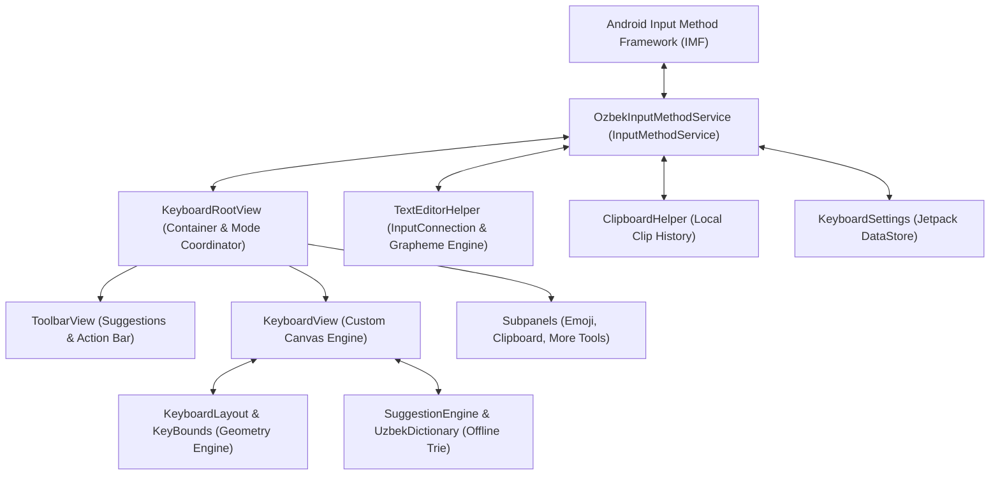

# Özbek Keyboard v2.0 — System Architecture

## 1. System Overview

Özbek Keyboard is a native Android Input Method Editor (IME) engineered specifically for Uzbek language typing with Samsung One UI visual ergonomics. It runs 100% offline, operates with zero network permissions, and directly connects to Android's Input Method Framework (`android.inputmethodservice.InputMethodService`).

---

## 2. Architectural Layers

### 2.1 IMF & Lifecycle Layer (`uz.ozbekkeyboard.ime`)
- **`OzbekInputMethodService`**: The core system service registered in `AndroidManifest.xml` with `BIND_INPUT_METHOD` permission.
  - Controls view instantiation (`onCreateInputView()`).
  - Intercepts editor field focus changes (`onStartInputView(EditorInfo, restarting)`).
  - Handles configuration changes (screen rotation, multi-window mode, system theme toggle).
  - Ensures clean shutdown and resource reclamation in `onDestroy()`.
- **`TextEditorHelper`**: High-level proxy between user gestures and `InputConnection`.
  - Performs atomic cursor navigation (`moveCursor()`), word replacement, punctuation auto-spacing, and Unicode-safe deletions.
  - Detects sensitive fields (passwords, PINs, card numbers) to disable suggestions and clipboard retention.

### 2.2 View & Canvas Rendering Layer (`uz.ozbekkeyboard.ui`)
- **`KeyboardRootView`**: Top-level `LinearLayout` orchestrating the keyboard hierarchy.
  - Dynamically swaps between the main typing surface (`KeyboardView`) and subpanels (`EmojiPanelView`, `ClipboardPanelView`, `NoticePanelView`).
- **`KeyboardView`**: High-performance custom `View` rendering keyboard keys directly via `android.graphics.Canvas`.
  - Avoids deprecated `android.inputmethodservice.KeyboardView`.
  - Maintains strict sub-16ms render passes with cached `Paint` and pre-measured geometry.
  - Renders Samsung One UI key shapes, depth shadows, Shift icons, and floating long-press popup menus.
- **`ToolbarView`**: Dedicated top bar displaying live word candidates from the suggestion engine, plus quick access actions (emojis, clipboard, number row toggle, settings).

### 2.3 Geometry & Layout Engine (`uz.ozbekkeyboard.layout`)
- **`KeyboardLayout`**: Deterministic state machine and key layout generator for:
  - `ALPHABET`: Standard QWERTY layout with optional number row.
  - `SYMBOLS_1`: Primary symbols, digits, mathematical operators, and page switcher `[1/2]`.
  - `SYMBOLS_2`: Secondary symbols, currencies, typographical punctuation, and page switcher `[2/2]`.
- **`KeyBounds`**: Standalone, pure Kotlin geometry representation. Computes bounding boxes `(left, top, right, bottom)` based on view dimensions, key weight proportions, and display density. Operates without `android.graphics.RectF` dependencies to enable pure JVM test execution.
- **`Key`**: Immutable definition of a key's label, shifted label, icon, weight, and variant mappings.

### 2.4 Typing Interaction Engines
- **Space Trackpad 2.0**: Long-press on the Space key activates cursor scrubbing mode. Finger drag translates into horizontal cursor movement without inserting accidental spaces. Operates on Unicode grapheme boundaries.
- **Long Press 2.0**: Long-press popup menu providing instant access to Uzbek Latin characters (`o → ö`, `g → ğ`, `s → ş`, `c → ç`) and extensible character sets. Supports touch-slide selection and release-to-commit.
- **Shift State Machine**: Triple-state transition (`OFF` → `SHIFTED` → `CAPS_LOCK` → `OFF`) with auto-capitalization detection after sentence-terminating punctuation.

### 2.5 Linguistic & Offline Storage Layer
- **`UzbekDictionary` & `SuggestionEngine`**: In-memory prefix Trie and frequency dictionary for instant candidate ranking.
- **`KeyboardSettings`**: Reactive configuration backed by Android Jetpack DataStore Preferences, storing theme preferences, vibration toggles, and layout heights.
- **`ClipboardHelper`**: Local, encrypted, opt-in clipboard cache with automatic password field filtering.

---

## 3. Linguistic Specification: Uzbek Alphabet Legal Status

In the development of Özbek Keyboard v2.0, precise linguistic fidelity is mandatory.

1. **Current Official Latin Alphabet (1995 Law):**
   - Official characters: `Oʻ oʻ` (O with inverted turned comma) and `Gʻ gʻ` (G with inverted turned comma), `Sh sh`, `Ch ch`, and the apostrophe / tutuq belgisi `ʼ` (U+02BC or U+02BB).
   - Widely utilized across all state institutions, schools, and legal documents in Uzbekistan.
2. **Reformed / Proposed Latin Alphabet (2021 & 2023 Drafts):**
   - Proposes replacing digraphs and comma-letters with diacritics:
     - `Oʻ / oʻ` → `Ö / ö`
     - `Gʻ / gʻ` → `Ğ / ğ`
     - `Sh / sh` → `Ş / ş`
     - `Ch / ch` → `Ç / ç`
   - *Legal Status:* Widely supported by linguists and published in draft legislation by the Oliy Majlis, but transition deadlines have been revised.
3. **Keyboard Implementation Approach:**
   - The keyboard provides **first-class native support for both**:
     - The default QWERTY layout includes seamless long-press popups for the new reformed characters (`ö`, `ğ`, `ş`, `ç`).
     - The keyboard simultaneously provides direct access to the official modifier comma/apostrophe `ʼ` and preserves standard typing of `oʻ`, `gʻ`, `sh`, and `ch`.
     - Word suggestions and autocorrect understand both orthographies.

---

## 4. Key Design Invariants

1. **Zero Disappearing Layouts:** Key bounds recalculation is strictly bound to `reloadLayout()`, `onLayout()`, and defensive checks in `onDraw()` and `onTouchEvent()`.
2. **Strict Offline Operation:** Zero network permissions (`android.permission.INTERNET` is forbidden).
3. **Unicode Grapheme Integrity:** Deletions and cursor navigation respect multi-byte Unicode surrogate pairs and combining diacritics.
4. **Samsung One UI Cohesion:** Visual design, key spacing, corner radii, and color palettes match modern Samsung Galaxy device guidelines.
