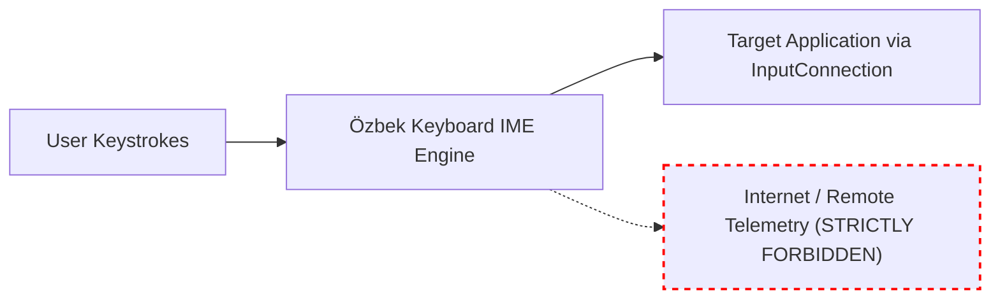

# Özbek Keyboard v2.0 — Privacy & Security Model

## 1. Zero Network Architecture

Privacy is the foundational design constraint of Özbek Keyboard. The application is architected to be completely disconnected from the Internet.



### Policy Rules
1. **No Internet Permission:** `android.permission.INTERNET` is explicitly omitted from `AndroidManifest.xml`. The OS kernel prohibits the keyboard from opening sockets, HTTP connections, or DNS queries.
2. **No Third-Party Analytics:** Zero analytics SDKs (no Firebase, no Crashlytics, no Google Analytics, no Facebook SDK).
3. **No Keylogging:** Keystrokes are passed directly to `InputConnection.commitText()`. No typed sentences are cached, logged to logcat, or persisted to disk.

---

## 2. Password & Sensitive Field Protection

Android applications specify field types via `EditorInfo.inputType`. Özbek Keyboard detects and protects sensitive fields automatically:

```kotlin
fun isPasswordField(info: EditorInfo?): Boolean {
    if (info == null) return false
    val variation = info.inputType and InputType.TYPE_MASK_VARIATION
    return variation == InputType.TYPE_TEXT_VARIATION_PASSWORD ||
           variation == InputType.TYPE_TEXT_VARIATION_VISIBLE_PASSWORD ||
           variation == InputType.TYPE_TEXT_VARIATION_WEB_PASSWORD ||
           info.inputType and InputType.TYPE_MASK_CLASS == InputType.TYPE_CLASS_NUMBER &&
           variation == InputType.TYPE_NUMBER_VARIATION_PASSWORD
}
```

### Sensitive Mode Invariants
- Word suggestions are disabled immediately (`updateSuggestions()` produces `emptyList()`).
- Autocorrect is bypassed completely.
- Clipboard auto-sync is blocked.
- Learning engines and personal dictionaries are bypassed.

---

## 3. Local Data Storage & User Purge Controls

All persistent data is stored strictly on local device storage:
- **Settings:** Stored in app-private Jetpack DataStore (`keyboard_settings.preferences_pb`).
- **Personal Dictionary:** Stored in app-private local storage.
- **Clipboard History:**
  - Fully opt-in.
  - User can view, individually delete, or purge all items with a single tap.
  - Automatically clears when the app is uninstalled or storage cleared.

---

## 4. Android & Samsung Knox Compliance

- **Direct Boot Awareness:** Registered with `android:directBootAware="true"` to provide keyboard functionality prior to first user unlock while strictly keeping user encrypted files protected.
- **Restricted Settings (Android 13/14/15):** The app provides transparent guidance for sideloaded installations to help users grant standard IME permissions without compromising Android security boundaries.
