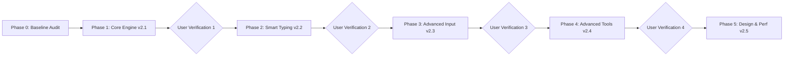

# Özbek Keyboard v2.0 — Development Roadmap

This roadmap defines the phased delivery plan for Özbek Keyboard v2.0. Each milestone produces a fully functional, self-contained, signed APK and requires passing regression tests.

---

## Phase 0: Baseline Audit & Verification (Milestone v2.0)
- **Status:** COMPLETED
- **Objectives:**
  - Audit existing `InputMethodService`, `KeyboardView`, `KeyboardLayout`, and `OnboardingActivity`.
  - Fix the critical symbol-switching disappearing keys bug.
  - Establish a clean Git baseline commit.
  - Run all baseline unit test suites.
- **Deliverable:** Baseline Git commit `7638cbb`.

---

## Phase 1: Core Typing Engine 2.0 (Milestone v2.1)
- **Status:** IN PROGRESS (Current Focus)
- **Key Deliverables:**
  1. **Space Trackpad 2.0**:
     - Smooth horizontal cursor scrub with configurable sensitivity.
     - Unicode grapheme cluster awareness: Never split emojis, surrogate pairs, or combined diacritics (`oʻ`, `gʻ`).
     - Absolute zero unwanted space insertions on trackpad initiation.
     - Robust gesture cancellation and touch interception.
  2. **Long Press 2.0**:
     - Complete Uzbek Latin reformed characters (`o → ö`, `g → ğ`, `s → ş`, `c → ç`) with uppercase pairs.
     - Secondary vowel/consonant alternative mappings.
     - Smooth touch-slide selection with high-contrast highlight.
     - Configurable long-press delay (200ms - 600ms).
  3. **Core Engine Upgrades**:
     - Unicode-safe Backspace deletion (single backspace clears full grapheme clusters and combining diacritics).
     - Accurate IME action mapping (`EditorInfo.IME_ACTION_SEARCH`, `SEND`, `DONE`, `GO`, `NEXT`).
     - Punctuation auto-spacing rules (double-space period).
     - Multi-theme compatibility with zero key-geometry regressions.
- **Acceptance Criteria:**
  - Space trackpad navigates cleanly across words without splitting graphemes or typing spaces.
  - Long press popup operates smoothly in lowercase and uppercase.
  - All modes (`ALPHABET`, `SYMBOLS_1`, `SYMBOLS_2`) switch flawlessly.
  - 100% unit tests pass.
- **Output Artifact:** `OzbekKeyboard-v2.1.apk`.

---

## Phase 2: Smart Uzbek Typing (Milestone v2.2)
- **Status:** PLANNED (Awaits Phase 1 User Confirmation)
- **Key Deliverables:**
  1. **Offline Uzbek Word Suggestions**:
     - Trie-based word dictionary with prefix lookups.
     - Frequency-ranked suggestions for top Uzbek words.
     - Support for both traditional (`oʻ`, `gʻ`) and reformed (`ö`, `ğ`) orthographies.
  2. **Conservative Autocorrect**:
     - Edit-distance candidate generation.
     - Non-destructive correction (never alters proper nouns or passwords).
     - Reversible suggestions with single-tap undo.
  3. **Personal Dictionary**:
     - User-added custom vocabulary.
     - Local storage backed by Room or DataStore.
     - Export / purge controls.
- **Output Artifact:** `OzbekKeyboard-v2.2.apk`.

---

## Phase 3: Advanced Input (Milestone v2.3)
- **Status:** PLANNED
- **Key Deliverables:**
  1. **Gesture / Swipe Typing**:
     - Continuous touch tracking across key centers.
     - Trie path matching algorithm.
     - Candidate generation bar.
  2. **Latin ↔ Cyrillic Transliteration**:
     - Context-aware rule-based transliterator (handles `yo`, `yu`, `ya`, `ts`, `ye`).
     - Pre-insertion preview and undo.
  3. **One-Handed Mode**:
     - Compact left / right alignment with quick-toggle side controls.
- **Output Artifact:** `OzbekKeyboard-v2.3.apk`.

---

## Phase 4: Advanced Tools (Milestone v2.4)
- **Status:** PLANNED
- **Key Deliverables:**
  1. **Categorized Emoji Search**:
     - Emoji categories, live search, and recent emojis.
  2. **Clipboard Manager 2.0**:
     - Pinned clips, manual deletion, auto-clear timer.
  3. **Translation Engine Research**:
     - Documented on-device or explicit opt-in provider architecture.
- **Output Artifact:** `OzbekKeyboard-v2.4.apk`.

---

## Phase 5: Design & Performance (Milestone v2.5)
- **Status:** PLANNED
- **Key Deliverables:**
  1. **Visual Refinement**:
     - Subtle keypress ripple / popup animation.
     - Responsive keyboard height slider.
  2. **Performance Tuning**:
     - Latency profiling (<16ms per frame, <8ms touch down latency).
     - Memory allocation optimization in onDraw loop.
- **Output Artifact:** `OzbekKeyboard-v2.5.apk` (Release Candidate).
