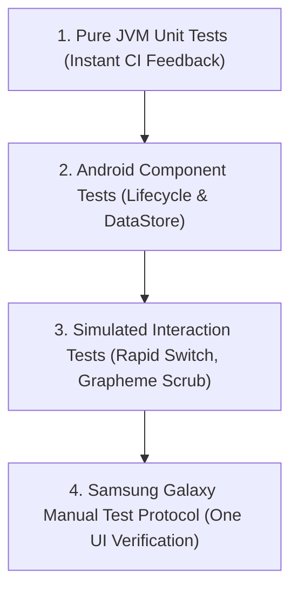

# Özbek Keyboard v2.0 — Quality Assurance & Test Plan

This document details the verification methodology for Özbek Keyboard across all milestones.

## 1. Test Levels & Strategy

---

## 2. Unit Testing Strategy

All core logic is architected into pure Kotlin modules to eliminate JVM unmocked Android dependencies and ensure test execution under 5 seconds:

| Test Class | Focus Area | Verification Criteria |
| :--- | :--- | :--- |
| `ModeSwitchingStateTest` | State Machine & Bounds | Validates transitions between `ALPHABET`, `SYMBOLS_1`, `SYMBOLS_2`. Guarantees non-empty `KeyBounds` for all keys. |
| `KeyboardLayoutTest` | Key Structure & Weights | Verifies row counts, weights summing to 10.0f, and elimination of non-standard symbols. |
| `ShiftStateMachineTest` | Capitalization | Verifies `OFF` → `SHIFTED` → `CAPS_LOCK` transitions, double-tap timing, and auto-reset. |
| `UzbekAlphabetAndVariantsTest` | Linguistic Fidelity | Verifies `o → ö`, `g → ğ`, `s → ş`, `c → ç`, uppercase counterparts, and apostrophe handling. |
| `GraphemeClusterTest` | Unicode Integrity | Tests cursor navigation over emojis, surrogate pairs, and combined characters without splitting. |
| `SuggestionEngineTest` | Trie Lookups | Validates prefix search, empty queries, case-insensitivity, and performance under 2ms. |
| `ThemeManagerTest` | UI Theming | Checks contrast, non-zero ARGB integers, and key corner radius consistency. |

---

## 3. Manual Samsung Galaxy Testing Protocol

Execute the following checklist on a physical Samsung device running One UI:

### Setup & Activation
- [ ] Open **Settings > General management > Keyboard list and default**.
- [ ] Enable **Özbek Keyboard**. Confirm standard Android security warning dialog.
- [ ] Set **Özbek Keyboard** as default input method.
- [ ] If on Android 13/14/15, verify Samsung Restricted Settings bypass functions if sideloaded.

### Typing & Modes
- [ ] Open **Telegram** or **Samsung Notes**. Focus text input.
- [ ] Type standard Uzbek sentence: `Oʻzbekiston kelajagi buyuk davlatdir.`
- [ ] Long-press `o` → slide to select `ö` → verify `ö` inserts cleanly without extra `o`.
- [ ] Long-press `g` → slide to select `ğ` → verify `ğ` inserts cleanly.
- [ ] Long-press `s` → slide to select `ş` → verify `ş` inserts cleanly.
- [ ] Long-press `c` → slide to select `ç` → verify `ç` inserts cleanly.
- [ ] Switch to Shift (`O`, `G`, `S`, `C`) and verify uppercase variants `Ö`, `Ğ`, `Ş`, `Ç`.
- [ ] Tap `!#1` → verify symbol page 1 displays all mathematical symbols.
- [ ] Tap `1/2` → verify symbol page 2 displays secondary symbols.
- [ ] Tap `2/2` → verify symbol page 1 returns.
- [ ] Tap `ABC` → verify QWERTY layout restores instantly.

### Space Trackpad 2.0
- [ ] Type a multi-word sentence: `Toshkent goʻzal shahar`.
- [ ] Press and hold the Space bar (`Özbekcha`) for >300ms.
- [ ] Observe subtle haptic buzz and visual highlight.
- [ ] Drag finger left and right across the spacebar.
- [ ] Confirm cursor moves smoothly between characters.
- [ ] Release finger: confirm **no space character** is inserted upon trackpad activation.
- [ ] Navigate past `gʻ`: confirm cursor jumps cleanly past the character cluster.
- [ ] Navigate past an emoji (e.g. 🇺🇿 or 😊): confirm emoji is not split into corrupt surrogate characters.

### Backspace & Enter
- [ ] Tap Backspace on an emoji: confirm single tap deletes entire emoji cleanly.
- [ ] Tap Backspace on `oʻ`: confirm single tap deletes `ʻ`, next tap deletes `o`.
- [ ] Hold Backspace: verify continuous auto-repeat deletion engages smoothly.
- [ ] In Google Search, verify Enter key displays Search icon and triggers query.
- [ ] In Telegram, verify Enter key displays Send icon and sends message.
- [ ] In Notes, verify Enter key inserts newline.

### Performance & Stability
- [ ] Rapidly switch between `ABC` and `!#1` 50 times in 10 seconds: verify zero crashes, zero blank areas.
- [ ] Rotate device between portrait and landscape: verify layout re-measures cleanly without clipping.
